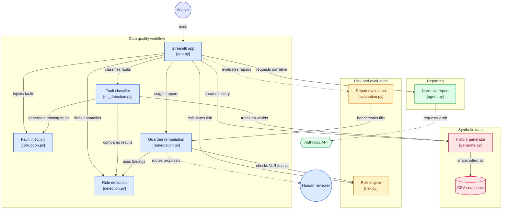

# Market Risk Data Lab

I built this to demonstrate the layer of market risk that rarely gets demo
apps: the data underneath the models. Trading book risk numbers (VaR,
stressed VaR, sensitivities, stress tests) all consume the same risk factor
time series, and when one series goes bad the numbers go quietly wrong. This
app injects realistic data faults into a synthetic six-factor history,
detects them with a model trained on synthetic faults, repairs them under
deterministic guardrails, and proves the repairs with a mask-and-recover
evaluation harness.

Live: https://market-risk-data-lab.streamlit.app

The design principle throughout: automated proposals, deterministic
acceptance, flagged and reversible changes. The LLM writes the morning
report; it never touches data, and a number-check guardrail rejects any
draft containing a figure not present in the computed facts.

## The finding

I built this expecting to show that bad data visibly distorts VaR. It
mostly does not, and that turned out to be the more useful result.

With the three faults injected, 99% VaR moves +0.2% and looks completely
normal. Expected shortfall on the same data moves +71%. The reason is
structural: 99% VaR over a 500 day window is the 5th worst day, so one
corrupt print shifts the ranking by a single place and the number absorbs
it. Expected shortfall averages the tail, so it takes the full weight of
the fake loss. Freezing every series for 20% of the lookback window still
leaves VaR unchanged.

Two things follow. You cannot use the headline risk number as your data
alarm, which is the argument for dedicated data quality monitoring. And
as the industry shifts from VaR toward expected shortfall, data errors
get more load bearing, not less.

After detection and repair, expected shortfall returns to within 0.5% of
its clean value with every applied point flagged. The stressed VaR window
search independently lands on the engineered 2022 high volatility era at
roughly 2.8x ordinary VaR.

## The detector: a model that learned the faults, because the injector is the teacher

An unsupervised model can only rank days as unusual. The fault injector
can manufacture unlimited labeled faults, so a gradient boosting
classifier is trained on sixteen synthetic histories full of planted
frozen feeds, bad prints, gaps and vendor level shifts, then run on the
demo history, which it never saw. It finds and correctly names all three
planted faults on every affected day, and scans six years in a fraction
of a second.

Measured on ten more histories it had never seen, about 100,000
series-days: 97% recall and 95% precision on fault days, with false
alarms on 0.02% of clean days. Broken down, it is essentially perfect on
sustained faults (gaps, frozen feeds) and around 60% on one-day events
(bad prints, level shifts), because one day is one data point and a big
move is genuinely ambiguous. That split drives the whole design.

## What happens to a fault, and why single-day calls need a person

Repairs are scored in date order against the data as it stands. A repair
that changes the series' own return distribution is rejected outright.
Everything else is applied, but a repair covering a single day is signed
off by a person first, because that is exactly where the detector is
weakest.

In the demo that rule earns its keep: four single-day repairs go for
sign-off and the reviewer turns down three of them, because they are real
2022 stress-era moves rather than faults. Zero real market moves are
repaired. Separately, the 20 day gap fill is rejected by the distribution
guardrail, because a straight line has no volatility, and those points
stay on an exception report until a person picks a proxy series.

## What it covers

How the modules fit together (each box is one file):

| Capability | Where |
|---|---|
| Time series construction (golden copy, seeded synthetic) | data/generate.py |
| The dataset as CSV, with a column dictionary | data/ |
| Fault injection: stale, spike, gap (vendor splice used in training worlds) | src/corruption.py |
| Anomaly detection: run-length, EWMA z-score, calendar, peer and reversal tiebreakers | src/detection.py |
| Remediation ladder, per-proposal KS and VaR-impact guardrails, accepted-only staging, flags | src/remediation.py |
| Historical simulation VaR, sVaR window search, ES, sensitivities, coherent stress scenarios, backtesting | src/risk.py |
| Mask-and-recover evaluation (MAE, KS, tail preservation) | src/evaluation.py |
| LLM narrative with number-check guardrail and template fallback | src/agent.py |
| Random forest imputation benchmarked against the simple methods | src/remediation.py, src/evaluation.py |
| Supervised fault classifier trained on synthetic worlds, tested on a held-out world | src/ml_detection.py |
| 76 tests, including a headless run of the app through every tab and widget | tests/ |

## Run it

    pip install -r requirements.txt
    streamlit run app.py
    python -m pytest tests/
    python -m data.export

Optional: set ANTHROPIC_API_KEY to enable the LLM morning report; without
it the deterministic template is used, which is the point of the fallback.

All data is synthetic and seeded. The portfolio is a toy book held as
sensitivities.
